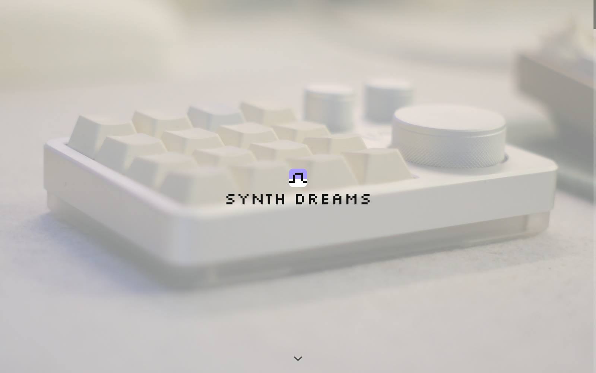
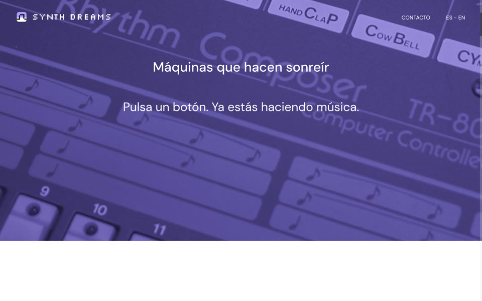
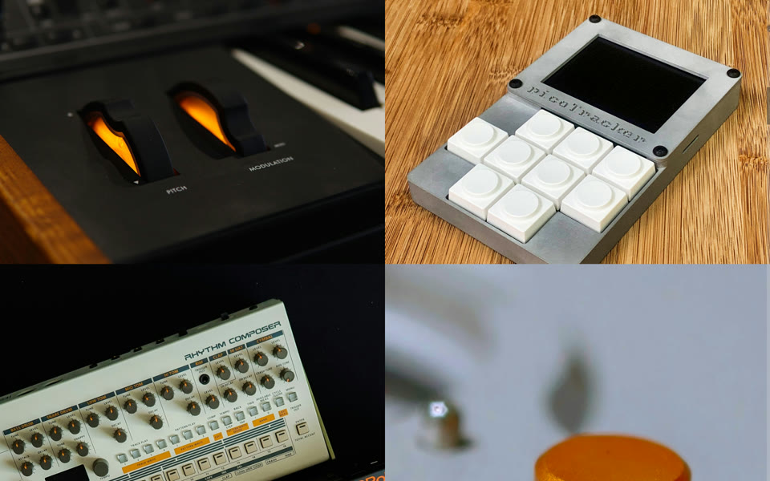
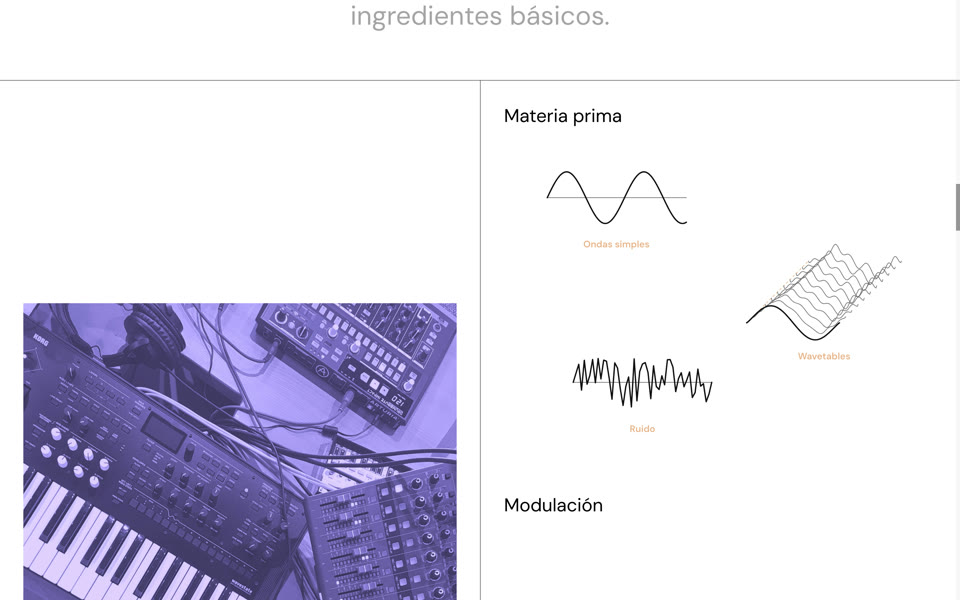
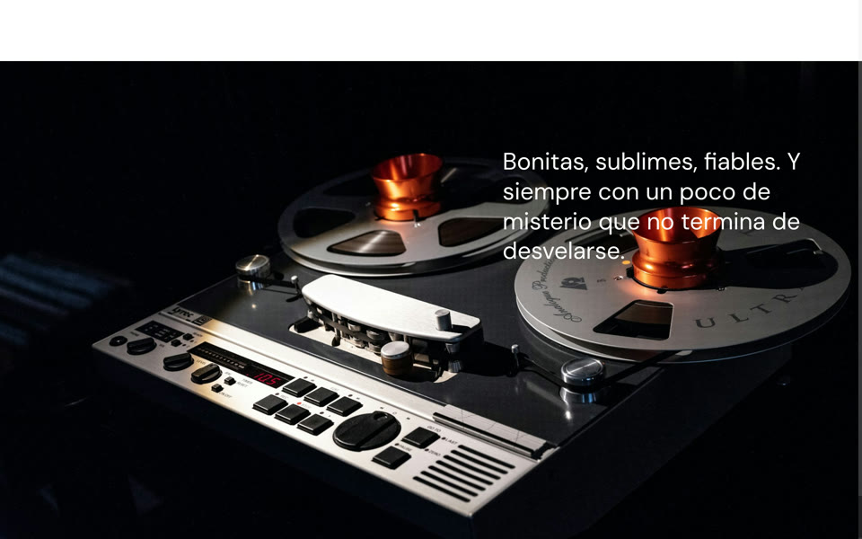

# Synth Dreams

A one-page, scroll-animated site about drum machines, synthesizers and colourful electronic gadgets: a love letter to the machines that make music, and a small guide for anyone who wants to start. Bilingual (Spanish / English), built with Django and GSAP.

**Live demo: [edealfonso.github.io/synth-dreams](https://edealfonso.github.io/synth-dreams/)**



<table>
  <tr>
    <td></td>
    <td></td>
  </tr>
  <tr>
    <td></td>
    <td></td>
  </tr>
</table>

## What it does

The home is a stack of seventeen full-screen blocks that react to the scroll: covers that stay pinned while the next block slides over them, parallax photos, galleries that scroll sideways, a list whose items light up as they reach the middle of the screen, and a short lesson on synthesis theory (sound sources, modulation, an effects chain) drawn as line pictograms that animate with the scroll.

- **Smooth scrolling that adapts to the device:** [smooth-scrollbar](https://github.com/idiotWu/smooth-scrollbar) on desktop, native scroll on touch devices, both wired to GSAP ScrollTrigger. On touch devices the galleries are pinned with CSS `position: sticky`, because native scroll runs ahead of JavaScript and anything moved by JS while scrolling jitters.
- **Header that adapts to the photo behind it:** the logo text and the menu turn white over dark photos, checking what is actually painted under each one (pinned blocks overlap).
- **All content editable from the Django admin**, in both languages, and reproducible: `seed_demo` loads every text and image from `seed/`, so a fresh clone (or the CI) gets the full site.
- **Published as a static site:** a management command renders every page to plain HTML, and a GitHub Action deploys it to GitHub Pages on every push to `main`.

## Technologies

- **Backend:** Python 3.12, Django 4.2, PostgreSQL 16, django-modeltranslation (ES/EN), django-solo, django-admin-sortable, django-ckeditor.
- **Frontend:** JavaScript ES modules bundled with webpack 5, GSAP 3 + ScrollTrigger, smooth-scrollbar, jQuery, SCSS (BEM, design tokens, `@use` modules), hand-written SVG.
- **Tooling:** Docker Compose (nothing installed on the host), GitHub Actions, GitHub Pages.

## What I built

- **Concept, content and visual identity:** the theme, every text in Spanish and English, the photo selection and editing (crops, duotones, recolouring, fades for legibility), the pixel logo and favicon, the UI icons and the synthesis pictograms and effects-chain drawing (hand-written SVG).
- **Animations:** the synthesis-theory block (drawings that fade in with the scroll, an effects chain whose cables draw themselves box by box), the scroll adjustments of several blocks, and the header that turns white over dark photos.
- **Frontend architecture refactor:** split one large script into ES modules with a single entry point, with a scroll layer that hides the desktop/touch difference; reorganised the SCSS into modules with BEM naming and design tokens. Both refactors were checked to change nothing visible (the positions of all ScrollTriggers and the computed styles of every element compared before and after).
- **Backend and data:** content models and admin, photo credits block, `seed_demo` (load / export the whole content), bug fixes.
- **DevOps:** Docker Compose setup, environment-based settings, support for serving the site under a URL subpath, the static export command and the GitHub Pages deployment.

## Run it locally

You only need Docker.

```bash
cp .env.example .env                                  # sample values work as they are
docker compose up --build                             # db + web + assets → http://localhost:8000
docker compose exec web python manage.py migrate
docker compose exec web python manage.py seed_demo    # loads the real content from seed/
docker compose exec web python manage.py createsuperuser   # optional: admin at /admin/
```

Static export (what GitHub Pages serves), into `dist/`:

```bash
make export
```

## Project layout

```
apps/pages/          # Home (blocks s01–s17), Header, Footer, legal pages, credits; seed_demo and export_static commands
apps/galleries/      # sortable gallery images
static/js/           # ES modules: core/ (scroll, screen, gsap), animations/ (one module per block), features/
static/scss/         # abstracts/ (tokens, mixins), base/, sections/, special/, templates/
templates/           # Django templates
seed/                # content (content.json) and images loaded by seed_demo
.github/workflows/   # GitHub Pages deployment
```

## Credits

Photos from [Unsplash](https://unsplash.com/license) and [Pexels](https://www.pexels.com/license/), credited one by one at the bottom of the site and in [`seed/credits.md`](seed/credits.md). Footer map: Ildefons Cerdà's 1859 plan of Barcelona (public domain). Fonts: DM Sans and Silkscreen (SIL Open Font License).

© Elsa de Alfonso
